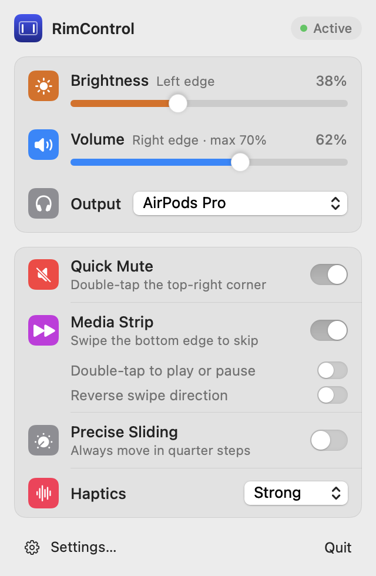
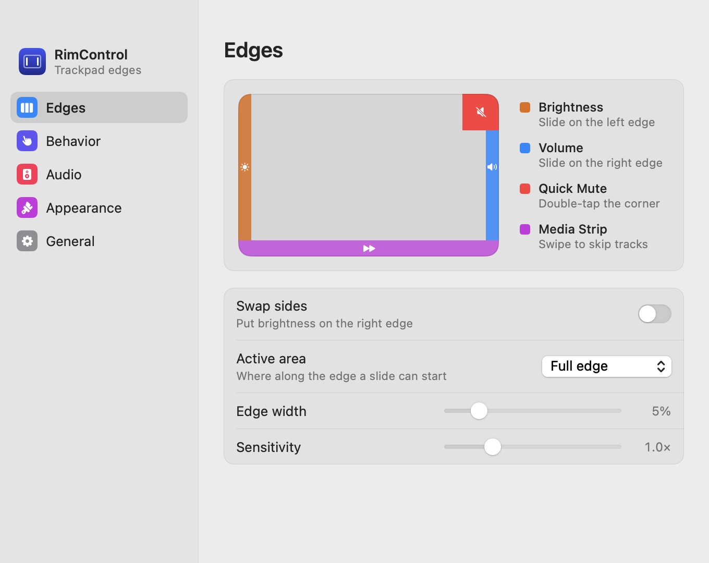
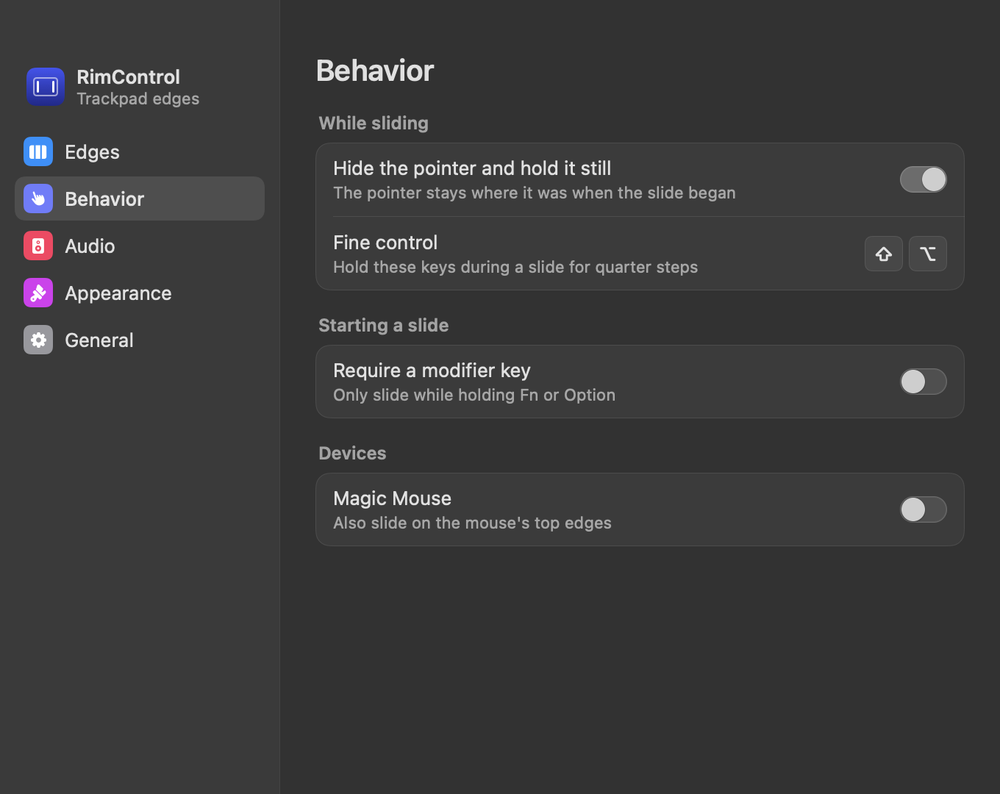
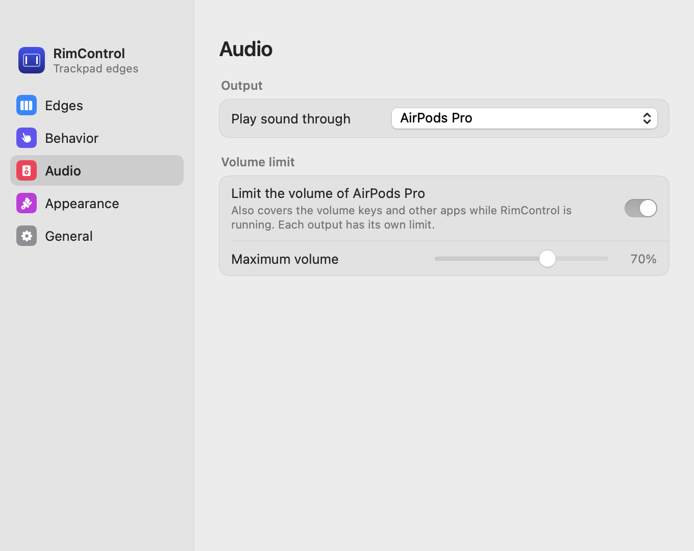
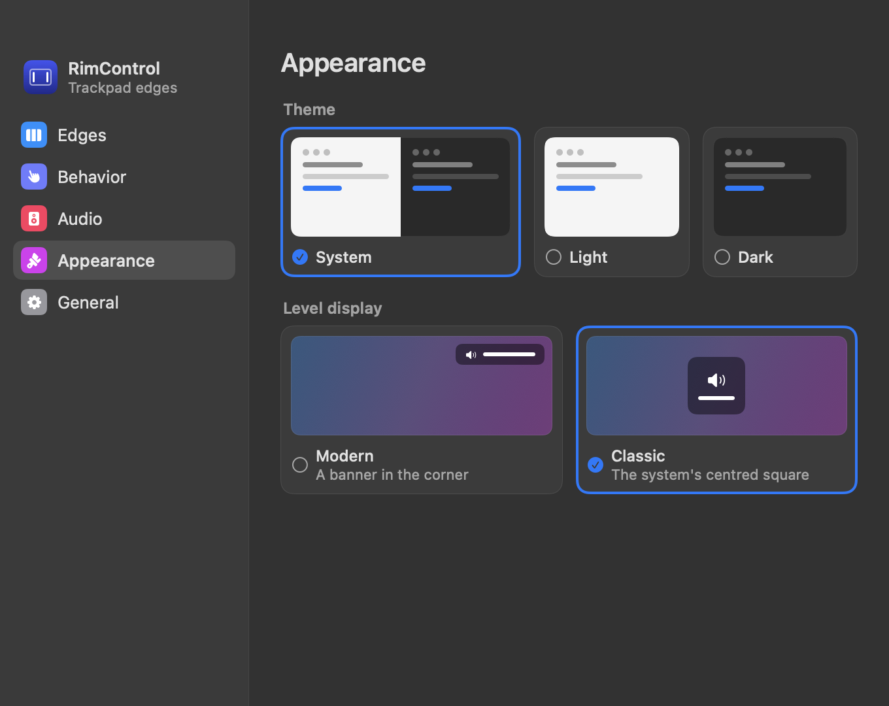
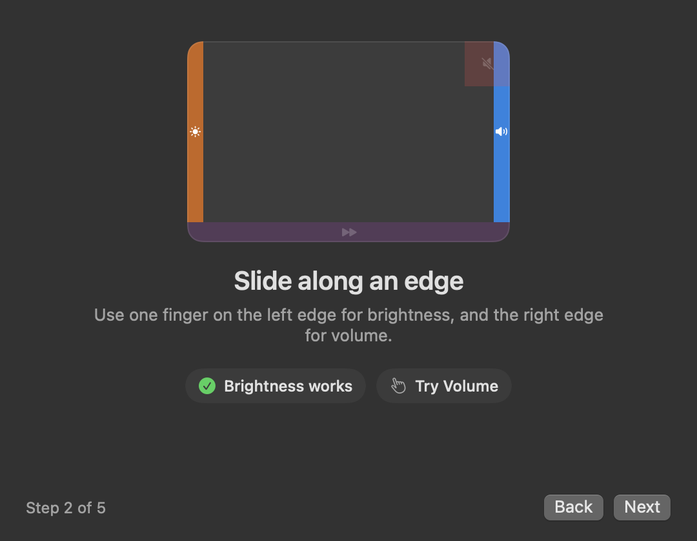
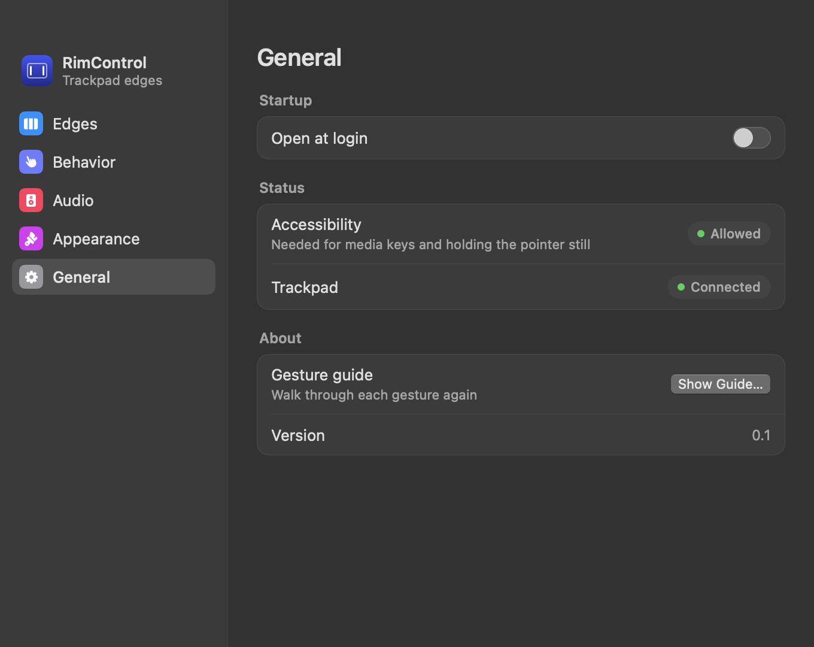
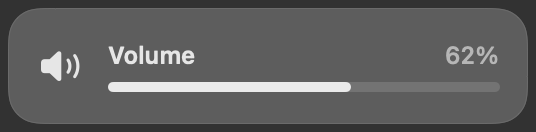
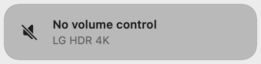

# RimControl

A macOS menu bar app that turns the edges of a MacBook trackpad into volume and brightness controls.
Slide along an edge to change a level, double-tap a corner to mute, or swipe the bottom edge to skip tracks.

<p align="center">
  <picture>
    <source media="(prefers-color-scheme: dark)" srcset="docs/screenshots/menu-dark.png">
    
  </picture>
</p>

Requires macOS 13 or later. Only a native build for the current architecture is produced.

## Screenshots

| Edges | Behavior |
| --- | --- |
|  |  |

| Audio | Appearance |
| --- | --- |
|  |  |

| Gesture guide | General |
| --- | --- |
|  |  |

The on-screen level display, and the message shown when an output can't be controlled:

<p>
  
  
</p>

## Build and run

```zsh
git clone <repository-url> rimcontrol
cd rimcontrol
./scripts/build-app.sh
open build/RimControl.app
```

Building needs the Xcode Command Line Tools with Swift 5.9 or later.

Grant Accessibility access when asked. It should carry over to later builds, because the build script ties
the signature to the app's identifier rather than its exact contents. If a toggle already shows as on but
nothing works, remove the entry in System Settings and add it again.

This signing is for local use only. Any app claiming the same identifier could inherit the access, so a
build you distribute needs a real signing certificate.

## Features

| Feature | How it works |
| --- | --- |
| Volume and brightness | Slide one finger along the right edge (volume) or left edge (brightness) |
| Swap Sides | Exchanges the two edges |
| Quick Mute | Double-tap the top-right corner |
| Media Strip | Swipe the bottom edge to skip tracks, with optional reverse direction |
| Play or pause | Optional double-tap on the bottom edge, off by default |
| Haptic Feedback | Off, Subtle, Standard or Strong, with a stronger buzz for mute |
| Fine Control | Hold Shift-Option for quarter steps |
| Precise Sliding | Quarter steps without holding keys |
| Cursor Freeze | The pointer hides and stays still during a slide |
| Active Area | Slides start anywhere, or only in the bottom ¾, half or quarter |
| Require modifier | Only slide while holding Fn or Option |
| Typing guard | Gestures pause briefly after a key press |
| HUD | Modern corner banner, or the Classic centred square. Track skips and messages always use the banner |
| Clear failures | The HUD explains when an output or display can't be controlled, and the pointer stays free |
| Audio output | Choose the output from the menu or Settings |
| Volume limit | A maximum for each output, which also covers the volume keys and other apps while the app runs |
| Gesture guide | Interactive walkthrough on first launch, and again from Settings > General |
| Magic Mouse | Optional slides on the mouse's top edges |
| Other | Edge width, sensitivity, Light or Dark, open at login, reconnects after wake |

## Commands

```zsh
# Gesture logic checks. No hardware is needed.
swift run RimCoreChecks

# Read-only report on each system integration.
build/RimControl.app/Contents/MacOS/RimControl --diagnose

# Print live touches, to confirm the undocumented touch layout.
build/RimControl.app/Contents/MacOS/RimControl --trace-touches

# Render every screen to PNGs for design review, in light and dark.
build/RimControl.app/Contents/MacOS/RimControl --snapshot-ui /absolute/output/folder

# Redraw the app icon after changing its design.
swift scripts/make-icon.swift Resources/AppIcon.icns
```

## Layout

- `Sources/RimCore`: the gesture state machine, with no system dependencies.
- `Sources/RimCoreChecks`: checks for the state machine.
- `Sources/RimControl`: the app and its macOS integrations.

| File | Responsibility | API |
| --- | --- | --- |
| `Multitouch.swift` | Touch input, haptics, reconnects | MultitouchSupport (private), IOKit |
| `SystemControls.swift` | Volume, audio outputs, brightness, media keys, login item | CoreAudio, DisplayServices (private), ServiceManagement |
| `CursorFreezer.swift` | Pointer freeze and click suppression | CGEvent taps, CGS connection property (private) |
| `HUD.swift` | Level display and messages | SwiftUI panel, OSDUIHelper XPC (private) |
| `Guide.swift` | First-run gesture guide | SwiftUI |

Private APIs can change in any macOS update. Each one is loaded at runtime and checked, so a missing
symbol disables that feature instead of crashing the app. Private API use also rules out the Mac App Store.

## Known limitations

- On macOS 26, the Modern level display is the app's own corner banner, not the system's glass HUD.
- Brightness is set directly, without the system's smooth easing on macOS 26.
- There are no automatic updates or universal binary.

Tuning values such as thresholds and timings can be found in `GestureConfig`.

## License

[MIT](LICENSE)
